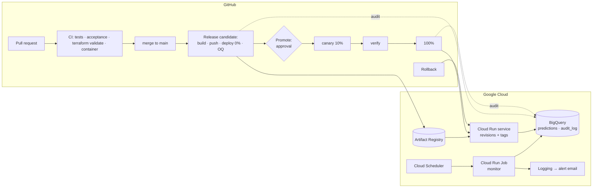

# BatchGuard: Pharma Batch Quality Risk, Released Like a Validated System

BatchGuard predicts whether a tablet-manufacturing batch is likely to **fail quality-control release testing**, using the batch's raw-material data and the sensor curves recorded during granulation, drying and compression. Batches at risk are flagged **hold for review** with the reasons behind the flag, so Quality Assurance can investigate before the batch is released.

Pharmaceutical manufacturing is a regulated (GMP/GxP) environment, so the project is built around how software is released there:

- **Infrastructure as code:** every cloud resource is defined in Terraform, so the environment can be recreated exactly.
- **Immutable releases:** the model is trained inside the container build. One image holds the code, the model and its validation report, and is identified by its digest.
- **Predefined acceptance criteria:** a model is releasable only if it meets fixed criteria on a fixed acceptance set, and training must be reproducible.
- **Operational qualification (OQ):** every new revision is deployed with **no traffic** and must pass a fixed test suite before anyone can use it.
- **Change control:** releasing requires a named person's approval (GitHub Environments). The rollout is a canary that is verified before it reaches 100%.
- **Audit trail:** every deployment, test result, promotion and rollback is appended to a BigQuery table.
- **Monitoring that suggests the cause:** a daily job tells raw-material changes apart from sensor-calibration drift, because they need different fixes.

All manufacturing data is synthetic and generated by the project.

---

## Contents

1. [How it works](#how-it-works)
2. [The process, data and model](#the-process-data-and-model)
3. [Acceptance criteria and validation](#acceptance-criteria-and-validation)
4. [The release process](#the-release-process)
5. [Monitoring](#monitoring)
6. [Project structure](#project-structure)
7. [Prerequisites](#prerequisites)
8. [Part A: Run locally](#part-a-run-locally)
9. [Part B: Set up Google Cloud and GitHub](#part-b-set-up-google-cloud-and-github)
10. [Part C: The first release](#part-c-the-first-release)
11. [Part D: Operate in production](#part-d-operate-in-production)
12. [API reference](#api-reference)
13. [Configuration reference](#configuration-reference)
14. [Command reference](#command-reference)
15. [Costs and shutting down](#costs-and-shutting-down)
16. [Troubleshooting](#troubleshooting)
17. [Design notes and limitations](#design-notes-and-limitations)

---

## How it works

| Component | Technology | Role |
|---|---|---|
| Infrastructure | Terraform | Creates every Google Cloud resource below, plus IAM and the GitHub sign-in |
| Release images | Artifact Registry | One image per release: code + model + validation report |
| API | Cloud Run service (private), Flask + gunicorn | Scores batches; every release is a revision |
| Traffic control | Cloud Run revisions and tags | Candidate at 0% → canary → 100%, instant rollback |
| Prediction log | BigQuery `batchguard.predictions` | Every scored batch, with the revision that scored it |
| Audit trail | BigQuery `batchguard.audit_log` | Every release event: who, what, when, which image |
| Monitoring | Cloud Run Job + Cloud Scheduler | Daily drift check, run from the same image as the live model |
| Alerting | Cloud Logging metric + Cloud Monitoring alert policies | Emails you on drift or server errors |
| Reports | Cloud Storage `gs://<project>-batchguard/reports` | Monitoring reports (JSON + Markdown) |
| CI/CD | GitHub Actions + Workload Identity Federation | Tests, builds, releases, promotes, rolls back. No key files |



---

## The process, data and model

### The manufacturing process

Each batch goes through three stages, each recorded as one reading per minute:

| Stage | Sensor | Readings |
|---|---|---|
| Wet granulation | `mixer_power` (kW) | 30 |
| Fluid-bed drying | `inlet_temp` (°C), `product_temp` (°C), `exhaust_humidity` (% RH) | 45 each |
| Compression | `compression_force` (kN), `tablet_weight` (mg) | 30 each |

Each batch also carries its **production line** (L1–L4), **shift**, **raw-material supplier**, and certificate-of-analysis values: API potency, incoming moisture and particle size (d50), plus ambient humidity.

Batches fail QC through realistic mechanisms: granulation that was too wet and wasn't fully dried, overheating during drying, erratic tablet weights, low API potency, and particle sizes far from normal. About 9–10% of batches fail.

`python -m batchguard.data` writes two files:

| File | Purpose |
|---|---|
| `data/train.jsonl` | 3,000 batches for training |
| `data/holdout.jsonl` | 1,500 batches: the fixed acceptance set every release is judged on |

Two scenarios simulate what happens in a real plant:

| Scenario | What changes | Effect |
|---|---|---|
| `new_supplier` | Raw material from a new supplier: coarser and wetter | More batches really fail |
| `sensor_drift` | The product-temperature probe reads 3 °C high | Nothing changes in the process, but the model's inputs are wrong |

### Features (shared by training and serving)

`src/batchguard/features.py` turns a raw batch into about 60 features. For every sensor it computes the mean, peak, minimum, variability, end-of-stage value, trend, and the average and largest **deviation from the golden batch**, the average curve of batches that passed QC. It adds minutes above 55 °C during drying, tablet-weight variability, the material values, and line, shift and supplier.

The fitted feature builder is saved **inside the model bundle**, and the API uses that same object. Training and serving therefore can't compute features differently, and a test checks this.

### Model and decision

- **Model:** gradient-boosted trees (`HistGradientBoostingClassifier`, fixed seed).
- **Operating threshold:** chosen on validation data as the highest risk cut-off that still catches **85% of failing batches**. Catching bad batches matters more than avoiding the occasional unnecessary review.
- **Decision:** `hold_for_review` if risk ≥ threshold, otherwise `proceed`.
- **Top factors:** for held batches, the three inputs that are both important to the model and furthest from normal, written for operators, for example `dryer exhaust humidity: average 2.9σ above normal`.

---

## Acceptance criteria and validation

Training (`python -m batchguard.train`) evaluates the model on the fixed acceptance set against criteria defined in `src/batchguard/config.py`. **All of them must pass**; otherwise training exits with an error and the release image can't be built.

| ID | Criterion |
|---|---|
| AC-1 | Recall on failed batches ≥ 0.80 |
| AC-2 | Precision of holds ≥ 0.25 |
| AC-3 | ROC AUC ≥ 0.85 |
| AC-4 | Recall on **every** production line ≥ 0.65 |
| AC-5 | p95 single-batch latency ≤ 100 ms |
| AC-6 | Retraining on the same data and seed reproduces identical predictions |
| AC-7 | *Only when recent batches are added:* recall ≥ 0.80 and AUC ≥ 0.85 on held-back recent batches |

Training writes four files to `artifacts/`:

| File | Contents |
|---|---|
| `model.joblib` | Feature builder, model, threshold, importances, identity |
| `metrics.json` | Acceptance-set metrics and the result of every criterion |
| `reference_profile.json` | Training-time distributions used by monitoring |
| `validation_report.md` | The release document |

The validation report records the model's **identity**: model version, source commit, fingerprints of the training and acceptance data, library versions and the threshold. It also states the intended use, the acceptance results, per-line performance, the most influential inputs and known limitations. In the cloud it's shown on the release run's summary page and kept as a workflow artifact for 90 days.

---

## The release process

```
merge to main ──▶ Release candidate ──▶ Promote (approval) ──▶ canary ──▶ verify ──▶ 100%
                  build+train inside      a named reviewer      10%        OQ again    monitoring job
                  push image              approves              of         + no        switched to the
                  deploy with 0% traffic                        traffic    errors      same image
                  OQ against candidate URL
```

1. **Release candidate** (`.github/workflows/release.yml`) runs on every push to `main` that changes `src/`, the `Dockerfile` or `requirements.txt`, and can also be started by hand. It:
   - builds the image, **training and validating the model during the build**;
   - extracts the validation report into the run summary;
   - pushes the image to Artifact Registry;
   - deploys it as a new Cloud Run revision with **0% traffic**, tagged `candidate` (the tag gives it its own URL);
   - runs operational qualification against that URL;
   - records `candidate_deployed` and `oq_passed` (or `oq_failed`) in the audit log.

2. **Operational qualification** (`src/batchguard/oq.py`) checks that the revision:
   - is healthy;
   - serves the expected model version;
   - reports all acceptance criteria met;
   - lets a typical batch proceed;
   - holds a deliberately bad batch, with reasons;
   - rejects a truncated sensor curve (422) and a malformed request (400);
   - responds quickly enough.

3. **Promote** (`.github/workflows/promote.yml`) is started by hand:
   - **canary:** waits for approval in the `production` environment, then sends 10% of traffic to the candidate and records `canary_started`;
   - **verify:** watches for 5 minutes, fails if the candidate revision logged any errors, and runs OQ again while it serves live traffic. If anything fails, it moves all traffic back and records `canary_failed`;
   - **full:** sends 100% to the candidate, switches the monitoring job to the same image, and records `promoted` with the previous revision.

4. **Rollback** (`.github/workflows/rollback.yml`) sends 100% of traffic back to the revision that served before the last promotion, or to any revision you name. It switches the monitoring job back too and records `rolled_back`. It needs no approval, because it's meant for emergencies, but it's always audited.

---

## Monitoring

The monitoring job (`python -m batchguard.monitor`) runs daily as a **Cloud Run Job** built from the same image as the live model, so it compares traffic against that exact model's training profile. It reads the last 24 hours of predictions from BigQuery and checks:

| Check | Detects |
|---|---|
| PSI of incoming moisture, particle size and API potency | Raw-material changes |
| PSI of peak and final product temperature, final exhaust humidity, final mixer power, tablet-weight variability | Process or sensor changes |
| PSI of predicted risk | The risk mix the model sees has changed |
| Hold-rate shift | Many more (or fewer) batches held than at training time |
| Share of batches from suppliers the model has never seen | New material sources |

PSI (population stability index): below 0.10 is stable, 0.10–0.25 is worth watching, and 0.25 or more means the population has moved.

When something alerts, the report **suggests the likely cause**:

- **Material inputs moved, or an unknown supplier appeared:** the raw material has changed. Investigate, then retrain with recent batches.
- **Only process sensors moved, with materials and suppliers normal:** check sensor calibration *first*. Retraining on a miscalibrated sensor would teach the model the fault.

Each run writes `reports/monitoring/<timestamp>.json` and `reports/monitoring/latest.md` to the bucket, shows the hold rate per Cloud Run revision (useful during a canary), and logs a structured `WARNING` when it alerts. A log-based metric turns that warning into an **email**. A second alert policy emails you if the API returns more than five server errors in five minutes.

---

## Project structure

```
pharma-batch-mlops/
├── src/batchguard/
│   ├── config.py        process definition, acceptance criteria, thresholds, settings
│   ├── data.py          synthetic batches + scenarios, data contract, fingerprints
│   ├── features.py      sensor curves -> features, golden batch, deviations
│   ├── model.py         model, threshold choice, evaluation, explanations, reference profile
│   ├── validation.py    acceptance criteria + validation report
│   ├── train.py         train, validate, package (fails if not releasable)
│   ├── app.py           Flask API
│   ├── oq.py            operational qualification suite
│   ├── monitor.py       daily drift job with likely-cause hints
│   ├── audit.py         append-only release audit trail
│   ├── sinks.py         JSONL locally, BigQuery in the cloud
│   ├── storage.py       report files: local folder or Cloud Storage
│   └── traffic.py       reads Cloud Run traffic state for the workflows
├── infra/terraform/     all cloud infrastructure
├── .github/workflows/   ci.yml, release.yml, promote.yml, rollback.yml
├── scripts/
│   ├── github_setup.sh  copies Terraform outputs to GitHub + creates the approval environment
│   └── send_batches.py  sends normal or scenario batches to the API
├── tests/               pytest suite
├── Dockerfile           multi-stage: install → train + validate → runtime
├── Makefile             shortcuts (run `make help`)
├── requirements.txt     pinned runtime and training dependencies
└── requirements-dev.txt adds pytest and ruff
```

---

## Prerequisites

**Tools.** On macOS with Homebrew:

```bash
brew install python@3.12 gh
brew install --cask google-cloud-sdk
brew tap hashicorp/tap && brew install hashicorp/tap/terraform
python3.12 --version && gcloud --version && terraform -version && gh --version
```

Docker Desktop is optional. It's only needed to build the image on your own machine, because GitHub Actions builds the release images.

**A Google Cloud project** with **billing enabled**, where your account is **Owner**. Setting a small budget alert (Billing → Budgets & alerts) is recommended.

**A public GitHub repository.** Required reviewers on GitHub Environments, which power the release approval, are available for public repositories on every plan. Private repositories need a paid GitHub plan for this feature.

**Python 3.12.** The dependencies are pinned to versions that match the container's runtime.

---

## Part A: Run locally

### A1. Install and test

```bash
cd pharma-batch-mlops
python3.12 -m venv .venv
source .venv/bin/activate
pip install -r requirements-dev.txt
pip install --no-deps -e .
pytest
```

Run `source .venv/bin/activate` in every new terminal for this project.

The tests cover the data contract, feature parity between bulk and single-batch scoring, threshold selection, model quality, reproducibility, explanations, the acceptance criteria, the API, the OQ suite, monitoring for each scenario, the audit trail and the traffic helper.

### A2. Train and read the validation report

```bash
make train
cat artifacts/validation_report.md
```

`make train` generates the data on first run, trains, checks every acceptance criterion and writes `artifacts/`. It exits with an error if the model isn't releasable.

### A3. Run the API and qualify it

In one terminal:

```bash
make serve                 # http://localhost:8080
```

In a second terminal:

```bash
source .venv/bin/activate
make oq-local              # the same OQ suite the cloud release runs
make traffic-local         # 200 batches
make monitor-local         # drift report over logs/predictions.jsonl
```

To see the monitoring hints, send scenario traffic and re-run the report:

```bash
python scripts/send_batches.py --url http://localhost:8080 --n 200 --scenario sensor_drift
make monitor-local         # 🔴 product temperature → check sensor calibration
```

For a clean comparison, delete `logs/predictions.jsonl` between scenarios, since the report covers all logged batches from the last 24 hours.

### A4. Retrain for a new supplier

```bash
make train-recent
cat artifacts_recent/validation_report.md
```

This adds 1,500 labelled batches made with the new supplier's material. 70% go into training and 30% are held back for criterion AC-7.

### A5. Build the release image (optional, needs Docker)

```bash
docker build -t batchguard:local --build-arg MODEL_VERSION=local .
docker run --rm -p 8080:8080 -e PREDICTION_SINK=jsonl:/tmp/p.jsonl batchguard:local
```

The model is trained during the build, so a model that fails its acceptance criteria makes the build fail.

---

## Part B: Set up Google Cloud and GitHub

You only do this part once.

### B1. Push the code to GitHub

```bash
git init
git branch -M main
git add .
git commit -m "BatchGuard: validated ML releases on Cloud Run"
gh auth login
gh repo create pharma-batch-mlops --public --source=. --remote=origin --push
```

**CI** runs immediately. It runs the tests, trains and checks acceptance, validates the Terraform, and builds and qualifies the container. **Release candidate** is skipped until step B5 connects Google Cloud.

### B2. Log in to Google Cloud

```bash
gcloud auth login
gcloud config set project <PROJECT_ID>
gcloud auth application-default login
gcloud auth application-default set-quota-project <PROJECT_ID>
```

Terraform uses the application-default credentials.

### B3. Fill in the Terraform variables

```bash
cp infra/terraform/terraform.tfvars.example infra/terraform/terraform.tfvars
```

Edit `infra/terraform/terraform.tfvars`:

```hcl
project_id  = "<PROJECT_ID>"
region      = "us-east1"
github_repo = "<your-github-username>/pharma-batch-mlops"
alert_email = "<your email>"
```

`github_repo` must match the repository's owner and name **exactly**. Only that repository will be allowed to deploy.

### B4. Create the infrastructure

```bash
make tf-init
make tf-plan          # review what will be created
make tf-apply         # type yes
```

The first apply takes about 3–6 minutes. Terraform:

- **turns on the APIs:** Cloud Run, Artifact Registry, BigQuery, Cloud Storage, Cloud Scheduler, Logging, Monitoring, IAM, IAM Credentials, Security Token Service and Cloud Resource Manager;
- **creates storage:** the Artifact Registry repository `batchguard`, the bucket `<project>-batchguard` (with versioning), and the BigQuery dataset `batchguard` with the day-partitioned tables `predictions` and `audit_log`;
- **creates three service accounts:**

  | Account | Used by | Can |
  |---|---|---|
  | `batchguard-runtime` | API and monitoring job | Write and query predictions, write reports and logs |
  | `batchguard-deployer` | GitHub Actions | Push images, deploy revisions and move traffic, write the audit log, read logs, call the service |
  | `batchguard-scheduler` | Cloud Scheduler | Start the monitoring job |

- **sets up Workload Identity Federation,** trusted only for your repository, including permission to mint identity tokens for the OQ tests;
- **creates the Cloud Run service `batchguard`** (private, scales to zero, with the custom audience `batchguard`) and the job **`batchguard-monitor`**. Both start with Google's placeholder images until the first release;
- **schedules monitoring** daily at 07:00 New York time;
- **sets up alerting:** an email notification channel and two alert policies, for drift and for server errors.

Terraform creates the service and the job, but GitHub Actions manages their revisions and traffic from then on (`ignore_changes = all`), so later `terraform apply` runs won't undo a release.

### B5. Connect GitHub

```bash
make github-setup
gh variable list
```

`scripts/github_setup.sh` copies Terraform's outputs into the repository's **Actions variables**: `GCP_PROJECT_ID`, `GCP_REGION`, `SERVICE_NAME`, `IMAGE_REPO`, `RUNTIME_SA`, `DEPLOYER_SA`, `WIF_PROVIDER`, `PREDICTIONS_TABLE`, `AUDIT_TABLE` and `REPORTS_URI`. It also creates the **`production` environment with you as its required reviewer**.

To check, open the repository's **Settings → Environments → production**. "Required reviewers" should list your account. To add a colleague as an approver, add them there.

---

## Part C: The first release

### C1. Build and qualify a candidate

Go to **Actions → Release candidate → Run workflow**, leave **recent** as `none`, and click **Run workflow**. From then on, every merge to `main` that changes `src/`, the `Dockerfile` or `requirements.txt` starts it automatically.

When it finishes (about 4–6 minutes), the run's summary page shows the **validation report**, the **OQ results** for the candidate URL and the next step. Check the traffic split:

```bash
make revisions
```

The `candidate` revision shows **0%**; the placeholder revision still serves everything.

### C2. Approve and promote

1. Go to **Actions → Promote → Run workflow**. Keep the defaults (10% canary for 5 minutes) and click **Run workflow**.
2. The run pauses with **"Waiting for review"**. Click **Review deployments**, tick **production**, add a comment if you like, and click **Approve and deploy**.
3. The canary starts, the verify job watches it for 5 minutes and re-runs OQ, and then the candidate receives 100%.

Check the result:

```bash
make revisions        # the new revision at 100%
make health           # {"status": "ok", "model_version": "...", "revision": "batchguard-0000x-..."}
make audit            # candidate_deployed, oq_passed, canary_started, promoted
```

---

## Part D: Operate in production

### D1. Score batches and look at the data

```bash
make traffic
```

In **BigQuery → Studio**, run:

```sql
-- hold rate per production line and revision, last 24 hours
SELECT revision, line, COUNT(*) AS batches,
       ROUND(AVG(IF(decision = 'hold_for_review', 1, 0)), 3) AS hold_rate
FROM `batchguard.predictions`
WHERE ts > TIMESTAMP_SUB(CURRENT_TIMESTAMP(), INTERVAL 1 DAY)
GROUP BY revision, line
ORDER BY revision, line;
```

```sql
-- most common reasons for holds
SELECT factor, COUNT(*) AS n
FROM `batchguard.predictions`, UNNEST(top_factors) AS factor
WHERE decision = 'hold_for_review'
GROUP BY factor ORDER BY n DESC LIMIT 10;
```

```sql
-- the release history
SELECT ts, event, revision, model_version, actor, run_url
FROM `batchguard.audit_log` ORDER BY ts DESC;
```

### D2. Run monitoring

The job runs every morning on its own. To run it now:

```bash
make monitor-run      # runs the job, waits, prints the report
```

After normal traffic, every check is 🟢. The monitoring job only works after the first promotion (Part C), because until then it still has the placeholder image.

### D3. A drifting temperature probe

```bash
make traffic-sensor
make monitor-run
```

The report flags product-temperature PSI and suggests **checking sensor calibration before retraining**. Within a few minutes the alert policy emails you, and the warning is also visible in **Logging → Logs Explorer**:

```
jsonPayload.message="batchguard monitoring"
severity=WARNING
```

### D4. A new raw-material supplier, and retraining

```bash
make traffic-supplier
make monitor-run
```

This time the report flags material inputs and the unknown supplier, and suggests **retraining with recent batches**. To do that:

1. Go to **Actions → Release candidate → Run workflow**, set **recent** to **`new_supplier`**, and click **Run workflow**.
2. The validation report now includes **AC-7**, performance on held-back recent batches, and its identity section lists the recent data's fingerprint.
3. Promote it as in C2. During the 5-minute canary, the hold-rate-by-revision query in D1 shows the old and new models side by side on live traffic.

To change the regime, always start a **new** run with **Run workflow**. **Re-run** on an earlier run repeats it with its original inputs.

### D5. Roll back

Go to **Actions → Rollback → Run workflow** and click **Run workflow**. Leave **revision** empty to restore the revision that served before the last promotion, or enter any revision name from `make revisions`.

```bash
make revisions        # previous revision back at 100%
make audit            # rolled_back entry
```

### D6. Change the code through a pull request

```bash
git checkout -b tune-threshold
# for example, change TARGET_RECALL in src/batchguard/config.py
git commit -am "Raise target recall"
git push -u origin tune-threshold
gh pr create --fill
```

CI runs the tests, trains and checks every acceptance criterion, validates the Terraform and builds the container. A change that makes the model unreleasable fails the pull request. After merging, **Release candidate** builds and qualifies a new candidate automatically, and you promote it as in C2.

---

## API reference

The service is private. Every request needs an identity token:

```bash
URL=$(make -s url)
TOKEN=$(gcloud auth print-identity-token)
```

### `GET /health`

```bash
curl -s -H "Authorization: Bearer $TOKEN" "$URL/health"
```

```json
{"status": "ok", "model_version": "3f9c2a1b7e4d", "revision": "batchguard-00003-xyz", "threshold": 0.0191}
```

### `GET /v1/model`

Returns the model's identity (version, commit, data fingerprints, library versions, suppliers it was trained on) and its acceptance results.

### `POST /v1/predict`

Send 1–200 batches:

```json
{
  "batches": [{
    "batch_id": "B-2026-0412",
    "line": "L2", "supplier": "SupA", "shift": "day",
    "api_potency": 99.8, "moisture_in": 2.1, "particle_d50": 84.0, "ambient_humidity": 46.0,
    "sensors": {
      "mixer_power":       [30 readings],
      "inlet_temp":        [45 readings],
      "product_temp":      [45 readings],
      "exhaust_humidity":  [45 readings],
      "compression_force": [30 readings],
      "tablet_weight":     [30 readings]
    }
  }]
}
```

`scripts/send_batches.py` and `src/batchguard/oq.py` build complete example requests.

Response:

```json
{
  "model_version": "3f9c2a1b7e4d",
  "revision": "batchguard-00003-xyz",
  "threshold": 0.0191,
  "results": [{
    "batch_id": "B-2026-0412",
    "request_id": "…",
    "risk": 0.4371,
    "decision": "hold_for_review",
    "top_factors": [
      "dryer exhaust humidity: average 2.9σ above normal",
      "API potency: value 4.5σ below normal",
      "tablet weight: relative variability 3.1σ above normal"
    ]
  }]
}
```

The values here are illustrative.

**Input rules:**

| Field | Rule |
|---|---|
| `line` | `L1`–`L4` |
| `shift` | `day` or `night` |
| `supplier` | Any non-empty string; suppliers not seen in training are scored as "other" and flagged by monitoring |
| `api_potency` | 90–110 (% label claim) |
| `moisture_in` | 0–8 (%) |
| `particle_d50` | 10–300 (µm) |
| `ambient_humidity` | 10–90 (% RH) |
| sensors | Exact lengths above, all numeric, within physical ranges |

**Errors:**

| Status | When |
|---|---|
| `400` | The body isn't `{"batches": [...]}`, or holds more than 200 batches |
| `413` | The request is larger than 8 MB |
| `422` | One or more batches break the contract; the response lists each problem by `batch_id` |

---

## Configuration reference

**Container environment** (set by the release workflow and Terraform):

| Variable | Cloud value | Local default |
|---|---|---|
| `MODEL_PATH` | `/app/artifacts/model.joblib` (in the image) | `artifacts/model.joblib` |
| `MODEL_VERSION` | Commit SHA (plus `-r<run>` for recent-data releases) | `dev` |
| `PREDICTION_SINK` | `bigquery:<project>.batchguard.predictions` | `jsonl:logs/predictions.jsonl` |
| `AUDIT_SINK` | `bigquery:<project>.batchguard.audit_log` (workflows) | `jsonl:logs/audit.jsonl` |
| `REPORTS_URI` | `gs://<project>-batchguard/reports` | `reports` |
| `MONITOR_WINDOW_HOURS` | `24` | `24` |

**Process limits, acceptance criteria and monitoring thresholds** are all in `src/batchguard/config.py`.

**Infrastructure settings** are in `infra/terraform/variables.tf`: region, service name, monitoring schedule and time zone, and the alert email.

---

## Command reference

| Command | What it does |
|---|---|
| `make test` | Run the test suite |
| `make train` / `make train-recent` | Train and validate locally (normal, or with new-supplier batches) |
| `make serve` | Run the API locally on port 8080 |
| `make oq-local` / `make traffic-local` / `make monitor-local` | Qualify, load and monitor the local API |
| `make tf-init` / `make tf-plan` / `make tf-apply` | Create or update the cloud infrastructure |
| `make github-setup` | Copy Terraform outputs to GitHub and create the approval environment |
| `make url` / `make health` | Service URL / live health check |
| `make traffic` / `make traffic-supplier` / `make traffic-sensor` | Send normal or scenario batches to the live service |
| `make monitor-run` | Run the monitoring job now and print its report |
| `make report` | Print the latest monitoring report |
| `make revisions` | Show the traffic split between revisions |
| `make audit` | Show the latest audit-log entries |
| `make tf-destroy` | Delete everything Terraform created |

---

## Costs and shutting down

When idle, the project costs close to nothing:

- the Cloud Run service scales to zero;
- the monitoring job runs once a day for under a minute;
- Cloud Scheduler includes three free jobs per billing account;
- the bucket and BigQuery tables hold a few MB;
- release images are a few hundred MB in Artifact Registry.

**To pause daily monitoring:**

```bash
gcloud scheduler jobs pause batchguard-monitor-daily --location=us-east1
```

Resume it with `gcloud scheduler jobs resume batchguard-monitor-daily --location=us-east1`.

**To remove everything:**

```bash
gh variable delete WIF_PROVIDER    # stops GitHub from releasing again
make tf-destroy                     # type yes
```

`terraform destroy` deletes the service, job, schedule, alerts, BigQuery dataset, bucket, image repository (including its images), service accounts and the Workload Identity pool. Google keeps deleted Workload Identity pools for 30 days. If you run `make tf-apply` again within that time, restore the pool first:

```bash
gcloud iam workload-identity-pools undelete github-batchguard --location=global
```

Alternatively, change `workload_identity_pool_id` in `main.tf`.

---

## Troubleshooting

| Symptom | Cause and fix |
|---|---|
| `pip` fails installing numpy or pandas | Not Python 3.12. Recreate the environment with `python3.12 -m venv .venv` |
| `terraform apply` fails with *API has not been used* or *SERVICE_DISABLED* | The APIs were just enabled and are still propagating. Wait 2 minutes and run `make tf-apply` again |
| `terraform apply` fails creating the drift alert policy (*cannot find metric*) | The new log-based metric isn't visible yet. Wait a minute and apply again |
| `terraform apply`: *quota project* or *billing* warnings | Run `gcloud auth application-default set-quota-project <PROJECT_ID>` |
| `make tf-apply` fails on the Workload Identity pool: *already exists* | A pool with that ID was deleted in the last 30 days. Undelete it (see above) or change its ID |
| Release candidate is skipped | GitHub variables aren't set. Run `make github-setup` |
| Sign-in fails: `unauthorized_client` / attribute condition | `github_repo` in `terraform.tfvars` doesn't exactly match the repository. Fix it, `make tf-apply`, re-run the workflow |
| Build fails at the training step | A model acceptance criterion failed. The build log shows which; the same check runs in CI on pull requests |
| `docker push`: permission denied | The deployer lacks Artifact Registry write access. `make tf-apply` again to restore it |
| OQ fails against the candidate | Open the failed step's table to see which check failed, then read the service's logs: `gcloud logging read 'resource.type="cloud_run_revision" AND resource.labels.service_name="batchguard"' --limit=50` |
| Promote doesn't wait for approval | The `production` environment has no required reviewer, or the repository is private on a free plan. Run `make github-setup` and check Settings → Environments |
| Promote fails with *No candidate revision* | Run **Release candidate** first |
| `make monitor-run` fails before the first promotion | The job still runs the placeholder image. Promote a release first |
| `403` from `make health` or `make traffic` | Your token is missing or expired: run `gcloud auth login` |
| No alert email arrives | The alert policy evaluates every few minutes. Check **Monitoring → Alerting** for the incident, and your spam folder |
| CI fails at lint | Run `ruff check src tests scripts --fix` locally, fix what's left and push |

---

## Design notes and limitations

- **One artifact per release.** The model is trained inside the image build, so the released image's digest identifies code, model, libraries and validation report together. Rolling back a revision rolls all of them back at once.
- **Criteria, not comparisons.** Releases are judged against fixed acceptance criteria on a fixed acceptance set, as validated systems are, and not only against the previous model.
- **Reproducibility is tested,** not assumed: AC-6 retrains with the same data and seed and requires identical predictions.
- **The API never fails a request because logging failed.** A BigQuery outage is logged as an ERROR, which the canary check and the server-error alert both watch.
- **The audit trail is append-only by design.** The workflows only ever insert rows. For stronger tamper resistance, restrict the deployer to a custom role that can insert but not delete, and export the table to a locked-retention bucket.
- **Approval identity.** The audit log links each promotion to its GitHub Actions run, where GitHub records who approved the `production` deployment and their comment.
- **Not a certified GxP system.** This project demonstrates the practices: change control, qualification, audit trail and monitoring. A real deployment would need formal validation documentation, user requirements and supplier assessments.
- **Synthetic data** is cleaner than real batch records, which have missing readings, varying batch durations and delayed laboratory results.

## License

MIT
